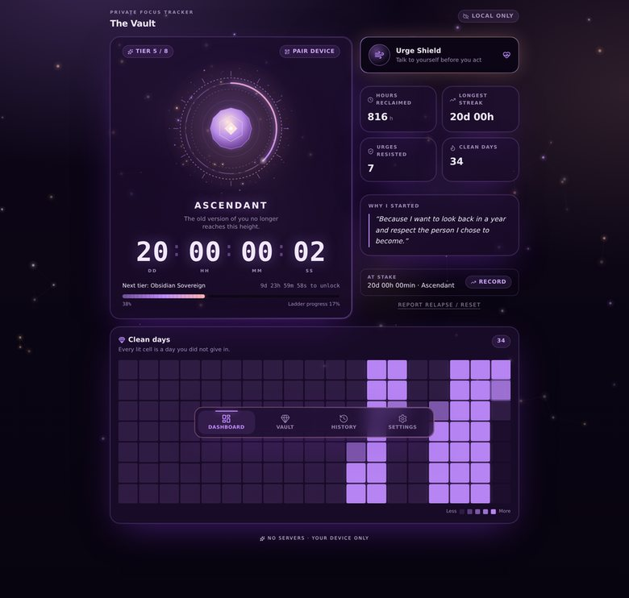

# Vault · Focus Streak

> A private, offline-first self-discipline & abstinence streak tracker with a progressive visual evolution system.
> **Un rastreador privado de rachas con un sistema visual que evoluciona contigo.**

<p>
  
  
  
  
  
  
</p>

- 🇬🇧 [English](#english) · 🇪🇸 [Español](#español)
- 🚀 [Deploy to GitHub Pages](#1-deploy-to-github-pages) · 🔗 [Cross-device sync](#2-cross-device-sync-github-gist) · 📱 [Pair PC + phone with a QR](#step-by-step-pair-pc--mobile-with-one-qr-scan)
- 🖼️ Screenshots: [dashboard](docs/preview-dashboard.jpg) · [tier vault](docs/preview-vault.jpg) · [desktop](docs/preview-desktop.jpg)

---

# English

## Why this exists

Streak apps usually punish you with a number. This one punishes you with **an aesthetic you do not want to lose**: every milestone transforms the entire interface — palette, glass borders, ambient canvas particles and an animated centrepiece relic. Relapsing does not just zero a counter, it *visibly* strips the aura away.

Everything runs in the browser. No backend, no accounts, no analytics. Cloud sync (optional) is done through a **private GitHub Gist that lives in your own GitHub account**.

## Features

**Progressive visual evolution — 8 tiers**

| Tier | Threshold | Design language |
| --- | --- | --- |
| Raw Ember | `0h – 24h` | Cold dark slate, matte borders, dim thin ring, minimal dust |
| First Spark | `1d – 3d` | Deep charcoal, indigo/amber warmth, gentle rising sparks |
| Iron Momentum | `3d – 7d` | Sapphire + cyan aurora tint, rotating dual orbital rings, progress trail |
| Forged Will | `7d – 14d` | Emerald-teal + brushed silver, rotating astrolabe geometry, star drift |
| Ascendant | `14d – 30d` | Royal violet + rose-gold nebula that reacts to pointer/touch |
| Obsidian Sovereign | `30d – 60d` | Obsidian + liquid gold crystal core, floating light motes |
| Solar Paragon | `60d – 90d` | Celestial gold + ivory/cyan highlights, solar corona, prestige crest |
| Transcendent | `90d+` | Prismatic diamond-gold aurora, full constellation halo, legendary relic |

**Loss aversion & anti-relapse**
- 🥇 **High-value metrics** — current tier, hours reclaimed, longest streak, urges resisted, clean-days heatmap.
- 🛡 **Urge Shield** — always one tap away: what is at stake, your own pledge, a guided **4-7-8 breathing orb**, and an “I resisted this urge (+1)” button.
- 🔒 **High-friction reset ritual** — no 1-click reset. Step 1 lists exactly what is destroyed, step 2 requires a 3-second hold (the UI visibly drains colour as you hold) or typing `RESET` / `REINICIAR`, step 3 archives the run with an optional private reflection.
- 🔭 **Tier Vault** — unlocked tiers in full glow, locked ones as mystery previews, plus a 5-second “Peek future tier” that you cannot keep.

**Privacy & ergonomics**
- 🌍 Full **Spanish / English** UI (defaults to Spanish when the browser is `es-*`).
- 🕵️ **Discreet mode + custom title** (`Focus Vault`, `Vitality`, `Deep Work`…) so it is safe to open in public.
- 📱 Mobile-first (no overflow at `360px`), bottom tab navigation, PWA installable, offline-first.
- 🔐 Token stored **only** in `localStorage`; never in source, never in the build.
- ⚡ Auto cross-device sync: on app load, on window focus / `visibilitychange`, and immediately after every mutation.

## Tech stack

Vite + React 19 + TypeScript (strict) + Tailwind CSS, `lucide-react` icons, `qrcode` for QR pairing, Vitest for unit tests. No router: tabs are React state, so a refresh can never 404 on GitHub Pages. `base: './'` keeps every asset URL relative, so the build works on any repository subpath.

## Quick start

```bash
npm install
npm run dev        # http://localhost:5173
npm test           # 72 unit tests (tiers, formatting, sync conflicts, pairing, storage)
npm run lint       # eslint (0 errors, 0 warnings)
npm run build      # tsc -b && vite build → dist/
npm run preview    # serve the production build locally
```

## 1. Deploy to GitHub Pages

1. **Create a repository** (public or private) and push this project to it:

   ```bash
   git remote add origin https://github.com/<your-user>/<your-repo>.git
   git add .
   git commit -m "feat: vault streak tracker"
   git push -u origin main
   ```

2. In the repository go to **Settings → Pages**.
3. Under **Build and deployment → Source**, choose **GitHub Actions** (not “Deploy from a branch”).
4. The included workflow [`.github/workflows/deploy.yml`](.github/workflows/deploy.yml) runs `npm ci`, `npm test`, `npm run build` and publishes `dist/` with the official actions (`actions/checkout`, `actions/setup-node`, `actions/configure-pages`, `actions/upload-pages-artifact`, `actions/deploy-pages`) on every push to `main`.
5. Wait for the green check in the **Actions** tab. Your app is live at:

   ```
   https://<your-user>.github.io/<your-repo>/
   ```

6. Optional (strongly recommended): **Settings → Pages → Visibility** and keep the repo private if you want, or at least remember the app content itself contains no personal data until you type it in.

> Refreshing any tab never 404s: routing is state-based, not path-based.

## 2. Cross-device sync (GitHub Gist)

Sync is **optional** and entirely serverless. Data lives in `localStorage` (instant, offline) and, if you enable it, in a **private Gist** inside your GitHub account.

### Step by step: create a Fine-Grained Personal Access Token

1. Open <https://github.com/settings/personal-access-tokens/new> (GitHub → **Settings → Developer settings → Personal access tokens → Fine-grained tokens → Generate new token**).
2. **Token name**: `Vault streak sync`.
3. **Expiration**: 90 days (or longer; renew it when it expires).
4. **Resource owner**: your own account.
5. **Repository access**: *Public repositories (read-only)* — the token needs **no repository access at all**.
6. **Permissions → Account permissions**: find **Gists** and set it to **Read and write**. Leave every other permission as *No access*.
7. Click **Generate token** and copy the value (`github_pat_…`). GitHub only shows it once.

### Connect

1. Open the app → **Settings → Cloud sync**.
2. Paste the token. Leave **Gist ID** empty — a new **private** Gist (`public: false`) containing `streak-data.json` is created automatically and its ID is saved for you.
3. Tap **Connect & sync**. The badge in the header turns to **Synced**.

> The token is stored only in this browser's `localStorage`. It is never hardcoded, never bundled, and never sent anywhere except `api.github.com`.

### Step by step: pair PC + mobile with one QR scan

1. Connect the cloud on your **PC** (token + automatic gist).
2. In the app tap **Pair device** (dashboard, top-right QR chip) or **Settings → Pair mobile via QR**.
3. On your **phone**, open the same GitHub Pages URL and scan the QR code with the camera app.
4. The link contains `#pair=<base64 {token, gistId}>`. On startup the app decodes the credentials into `localStorage`, then **immediately strips the hash** with `history.replaceState` (so it never lingers in the URL bar, history or a screenshot), and pulls the remote data straight away.

> ⚠️ **Never screenshot or share that QR code.** It contains your GitHub token: anyone who scans it can read and rewrite your data. If it leaks, revoke the token on GitHub, generate a new one, and re-pair. The app shows this warning in the pairing modal as well.

### Manual backups

**Settings → Backup** → **Export JSON** downloads a complete snapshot (`vault-backup-YYYY-MM-DD.json`) and **Import JSON** restores it on any device, no token required.

### How the sync engine resolves conflicts

- Every mutation stamps `updatedAt` with a **monotonic** ISO timestamp (never older than the previous value), so a device with a slow clock cannot silently overwrite a newer write.
- On load / focus / after each change the engine GETs the gist and compares `updatedAt` with the local copy: newest wins. Identical timestamps + different payload resolve deterministically toward the remote so both devices converge.
- A **blank fresh install** (no streak, no history, no urges, no pledge) never clobbers a real remote streak — and an empty gist never wipes real local progress.
- `GET` always uses `cache: 'no-store'`; updates always use the literal **uppercase** `'PATCH'` (lowercase method strings can break the CORS preflight in some browsers). Both are covered by unit tests.
- Failed syncs never lose data: the app keeps working from `localStorage` and shows **Sync Error** with a readable reason.

## Data model (`src/types/streak.ts`)

```json
{
  "version": 1,
  "updatedAt": "2026-11-23T17:04:05.123Z",
  "activeChallengeStart": "2026-11-03T09:12:00.000Z",
  "urgesResisted": 12,
  "personalPledge": "Because I want to respect the person I am becoming.",
  "history": [
    {
      "id": "a1b2c3",
      "startedAt": "2026-10-01T08:00:00.000Z",
      "endedAt": "2026-10-15T21:30:00.000Z",
      "durationSeconds": 1254600,
      "maxTierId": "ascendant",
      "note": "Late night, old habit, no plan."
    }
  ],
  "preferences": { "language": "es", "discreetMode": true, "customTitle": "Focus Vault" }
}
```

Credentials are stored **separately** (`vault.credentials.v1`) so an exported backup never contains your token.

## Privacy

- No analytics, no telemetry, no third-party scripts, no fonts or images fetched from a CDN at runtime.
- `noindex, nofollow` and `referrer: no-referrer` meta tags.
- Your data leaves the browser only when *you* configure a token — and then it goes directly to `api.github.com`, into a gist owned by your account.

## Project structure

```
.github/workflows/deploy.yml   GitHub Pages (Actions) pipeline
public/                        manifest, SVG icon, PNG icons, offline shell (sw.js)
src/
  components/                  AuraRelic (SVG + canvas), ParticleField, modals, tabs…
  i18n/                        ES/EN dictionaries + context
  lib/                         tiers, time formatting, stats/heatmap, storage, pairing
  services/gistSync.ts         Gist REST client, conflict resolution, sync engine
  state/useVault.ts            state + mutations + sync orchestration
  types/streak.ts              persisted data contract
  test/                        Vitest setup
  **/*.test.ts                 unit tests
```

## Testing

```bash
npm test
```

Coverage highlights: tier threshold boundaries (including exact `24h`/`90d` edges), progress maths, `DD : HH : MM : SS` formatting, negative/invalid elapsed clamping, Gist conflict resolution (local vs remote vs tie vs blank install), uppercase `PATCH` + `cache: 'no-store'` assertions, private-gist creation, pairing payload round-trip and hash stripping, storage sanitisation of corrupt imports.

## Troubleshooting

| Symptom | Fix |
| --- | --- |
| Page 404s after a refresh | You are on branch deployment or a custom 404 page is intercepting. Follow step 2 and use **Source: GitHub Actions**. |
| Badge stuck on **Sync Error** | Open **Settings** — the exact reason is shown. `401` → token invalid/expired; `403` → missing *Gists: Read and write* or rate limit; `404` → gist deleted (the app creates a new one automatically). |
| Pairing link does nothing | The QR must be opened on the **same deployment URL**; if you edited the URL, the `#pair=` payload must be the last fragment. Re-generate the QR. |
| Data on a second device is older | The newest `updatedAt` wins by design; open the device with the newest data and tap the header badge to push, then focus the other device. |
| Turn off sync | **Settings → Disconnect**. Local data stays untouched. |

## License

MIT — do whatever you want, just do not break your own streak.

---

# Español

## Por qué existe

Las apps de rachas suelen castigarte con un número. Esta te castiga con **una estética que no quieres perder**: cada hito transforma toda la interfaz — paleta, bordes de cristal, partículas ambientales en canvas y una reliquia central animada. Una recaída no solo pone un contador a cero: te **arranca el aura** a la vista.

Todo funciona en el navegador. Sin backend, sin cuentas, sin analíticas. La sincronización en la nube (opcional) usa un **Gist privado de GitHub dentro de tu propia cuenta**.

## Funciones

**Evolución visual progresiva — 8 rangos**

| Rango | Umbral | Lenguaje visual |
| --- | --- | --- |
| Brasa Cruda | `0h – 24h` | Pizarra fría, bordes mate, anillo tenue, polvo mínimo |
| Primera Chispa | `1d – 3d` | Carbón profundo, calidez índigo/ámbar, chispas ascendentes |
| Impulso de Hierro | `3d – 7d` | Aurora zafiro + cian, anillos orbitales dobles, rastro luminoso |
| Voluntad Forjada | `7d – 14d` | Esmeralda + plata cepillada, astrolabio giratorio, deriva de estrellas |
| Ascendente | `14d – 30d` | Violeta real + oro rosa, nebulosa que reacciona al puntero/tacto |
| Soberano de Obsidiana | `30d – 60d` | Obsidiana + oro líquido, cristal dorado, motas flotantes |
| Parangón Solar | `60d – 90d` | Oro celestial + marfil/cian, corona solar, escudo de prestigio |
| Trascendente | `90d+` | Aurora prismática diamante-oro, constelación completa, reliquia legendaria |

**Aversión a la pérdida y anti-recaída**
- 🥇 **Métricas de alto valor** — rango actual, horas recuperadas, racha máxima, impulsos resistidos, mapa de días limpios.
- 🛡 **Escudo de impulso** — siempre a un toque: lo que está en juego, tu juramento, un **orbículo de respiración 4-7-8** y el botón “Resistí este impulso (+1)”.
- 🔒 **Ritual de reinicio con alta fricción** — sin botón de un clic. Paso 1 enumera exactamente lo que se destruye, paso 2 exige mantener pulsado 3 segundos (la interfaz **pierde el color** mientras sostienes) o escribir `RESET` / `REINICIAR`, paso 3 archiva la racha con una reflexión privada opcional.
- 🔭 **Bóveda de rangos** — los desbloqueados con todo su brillo, los futuros como misterio, y un “Espiar rango futuro” de 5 segundos que no puedes conservar.

**Privacidad y ergonomía**
- 🌍 Interfaz completa **español / inglés** (por defecto español si el navegador es `es-*`).
- 🕵️ **Modo discreto + título personalizado** (`Focus Vault`, `Vitalidad`, `Deep Work`…) para abrirla en público sin problemas.
- 📱 Mobile-first (sin desbordes a `360px`), navegación inferior por pestañas, instalable como PWA, funciona sin conexión.
- 🔐 Token guardado **solo** en `localStorage`; nunca en el código ni en el build.
- ⚡ Sync automática: al abrir, al enfocar la ventana / `visibilitychange` y justo después de cada cambio.

## Puesta en marcha

```bash
npm install
npm run dev        # http://localhost:5173
npm test           # 72 tests unitarios
npm run lint       # eslint (0 errores, 0 avisos)
npm run build      # tsc -b && vite build → dist/
```

## 1. Desplegar en GitHub Pages

1. **Crea un repositorio** y sube el proyecto:

   ```bash
   git remote add origin https://github.com/<tu-usuario>/<tu-repo>.git
   git add .
   git commit -m "feat: rastreador de rachas"
   git push -u origin main
   ```

2. Ve a **Settings → Pages**.
3. En **Build and deployment → Source** elige **GitHub Actions** (no “Deploy from a branch”).
4. El workflow incluido [`.github/workflows/deploy.yml`](.github/workflows/deploy.yml) ejecuta `npm ci`, `npm test`, `npm run build` y publica `dist/` con las acciones oficiales (`actions/checkout`, `actions/setup-node`, `actions/configure-pages`, `actions/upload-pages-artifact`, `actions/deploy-pages`) en cada push a `main`.
5. Espera el check verde en la pestaña **Actions**. Tu app queda en:

   ```
   https://<tu-usuario>.github.io/<tu-repo>/
   ```

6. Recargar nunca da 404: la navegación es por estado, no por rutas.

## 2. Sincronización entre dispositivos (GitHub Gist)

Es **opcional** y totalmente sin servidor. Los datos viven en `localStorage` (instantáneo, offline) y, si lo activas, en un **Gist privado** de tu cuenta de GitHub.

### Paso a paso: crear un token personal *fine-grained*

1. Abre <https://github.com/settings/personal-access-tokens/new> (GitHub → **Settings → Developer settings → Personal access tokens → Fine-grained tokens → Generate new token**).
2. **Token name**: `Vault streak sync`.
3. **Expiration**: 90 días (o más; renuévalo cuando caduque).
4. **Resource owner**: tu propia cuenta.
5. **Repository access**: *Public repositories (read-only)* — el token **no necesita acceso a repositorios**.
6. **Permissions → Account permissions**: busca **Gists** y ponlo en **Read and write**. Deja todos los demás permisos en *No access*.
7. Pulsa **Generate token** y copia el valor (`github_pat_…`). GitHub solo lo muestra una vez.

### Conectar

1. Abre la app → **Ajustes → Sincronización en la nube**.
2. Pega el token. Deja el **ID del Gist** vacío: se crea automáticamente un Gist **privado** (`public: false`) con `streak-data.json` y su ID queda guardado.
3. Pulsa **Conectar y sincronizar**. El indicador de la cabecera pasa a **Sincronizado**.

> El token se guarda solo en el `localStorage` de este navegador. Nunca va en el código, nunca se empaqueta y solo se envía a `api.github.com`.

### Paso a paso: vincular PC + móvil con un solo escaneo QR

1. Conecta la nube en tu **PC** (token + gist automático).
2. En la app pulsa **Vincular dispositivo** (chip QR arriba a la derecha del panel) o **Ajustes → Vincular móvil por QR**.
3. En el **móvil**, abre la misma URL de GitHub Pages y escanea el QR con la cámara.
4. El enlace contiene `#pair=<base64 {token, gistId}>`. Al arrancar, la app decodifica las credenciales a `localStorage`, **borra el hash inmediatamente** con `history.replaceState` (para que no quede en la barra de direcciones, el historial ni una captura) y hace un pull inmediato de los datos.

> ⚠️ **Nunca captures ni compartas ese código QR.** Contiene tu token de GitHub: quien lo escanee puede leer y reescribir tus datos. Si se filtra, revoca el token en GitHub, genera otro y vuelve a vincular. La app muestra este aviso también en el modal.

### Respaldos manuales

**Ajustes → Respaldo** → **Exportar JSON** descarga una copia completa (`vault-backup-AAAA-MM-DD.json`) e **Importar JSON** la restaura en cualquier dispositivo, sin token.

### Cómo se resuelven los conflictos

- Cada cambio sella `updatedAt` con una marca ISO **monotónica** (nunca anterior a la previa), así un dispositivo con reloj atrasado no puede pisar una escritura más nueva.
- Al abrir, al enfocar y tras cada cambio, el motor hace GET del gist y compara `updatedAt` con la copia local: gana la más reciente. Si las marcas coinciden y el contenido difiere, se resuelve de forma determinista hacia el remoto para que ambos dispositivos converjan.
- Una **instalación nueva y vacía** (sin racha, historial, impulsos ni juramento) nunca sobrescribe una racha remota real, y un gist vacío nunca borra el progreso local.
- `GET` siempre con `cache: 'no-store'`; las actualizaciones siempre con `'PATCH'` en **mayúsculas** (un método en minúsculas puede romper el preflight CORS en algunos navegadores). Ambos casos están cubiertos por tests.
- Una sync fallida nunca pierde datos: la app sigue funcionando desde `localStorage` y muestra **Error de sync** con el motivo.

## Modelo de datos

Igual que el JSON del apartado inglés. Las credenciales se guardan **aparte** (`vault.credentials.v1`), así un respaldo exportado nunca incluye tu token.

## Privacidad

- Sin analíticas, sin telemetría, sin scripts de terceros, sin fuentes ni imágenes desde CDN en tiempo de ejecución.
- Metadatos `noindex, nofollow` y `referrer: no-referrer`.
- Tus datos solo salen del navegador cuando *tú* configuras un token — y entonces van directos a `api.github.com`, a un gist de tu cuenta.

## Solución de problemas

| Síntoma | Solución |
| --- | --- |
| 404 al recargar | Estás desplegando desde una rama o hay una página 404 personalizada. Sigue el paso 2 y usa **Source: GitHub Actions**. |
| El indicador queda en **Error de sync** | Abre **Ajustes** y verás el motivo exacto. `401` → token inválido/caducado; `403` → falta *Gists: Read and write* o límite de peticiones; `404` → gist eliminado (la app crea uno nuevo automáticamente). |
| El enlace de vinculación no hace nada | El QR debe abrirse en la **misma URL** del despliegue; el fragmento `#pair=` debe ser el último. Regenera el QR. |
| Los datos del segundo dispositivo están viejos | Gana el `updatedAt` más reciente por diseño; abre el dispositivo más actualizado, toca el indicador de la cabecera y enfoca el otro. |
| Quiero desactivar la sync | **Ajustes → Desconectar**. Los datos locales no se tocan. |

## Licencia

MIT — haz lo que quieras, pero no rompas tu propia racha.
